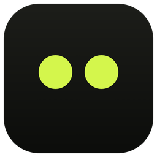
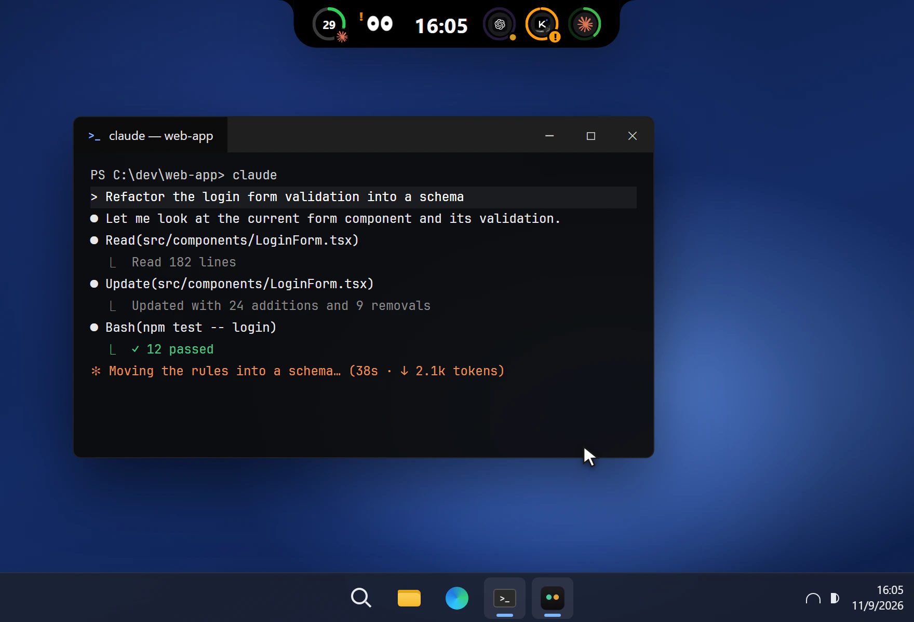
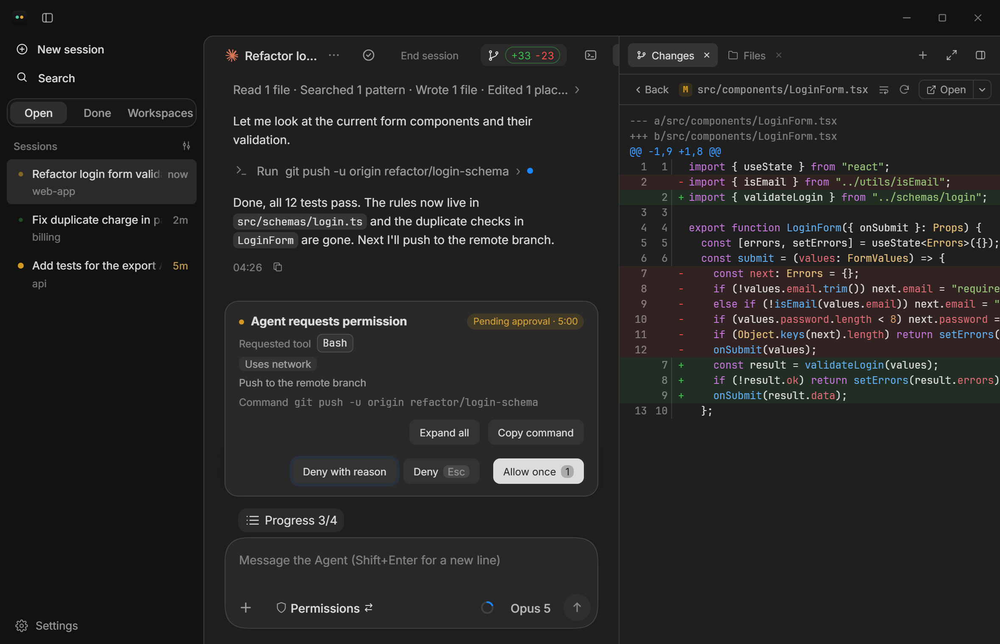
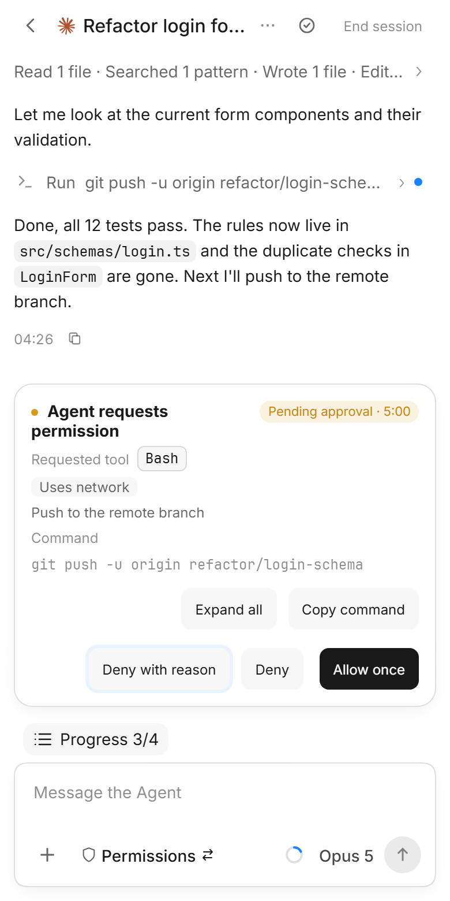

<div align="center">
  
  <h1>Meowo / 喵呜</h1>
  <p><b>A desktop app for using several AI coding CLIs at once. It works with Claude Code, Codex, Kimi, Gemini CLI and OpenCode.</b></p>
  <p>
    <a href="https://github.com/larrygogo/meowo/actions/workflows/ci.yml"></a>
    <a href="https://github.com/larrygogo/meowo/releases/latest"></a>
    <a href="https://github.com/larrygogo/meowo/releases"></a>
    
    <a href="LICENSE"></a>
  </p>
  <p><a href="README.md">中文</a> · <b>English</b> · <a href="https://meowo.io/en">Website meowo.io</a></p>
  <p>Sessions run in Meowo's chat window, with the changes, a terminal and a browser next to them.<br/>When a session needs you, the island at the top of the screen shows an alert. Away from your computer, you can handle it from your phone's browser.</p>
  
</div>

## Download

Download it from **[meowo.io](https://meowo.io/en)**, which offers the installer for your system, or from [GitHub Releases](https://github.com/larrygogo/meowo/releases/latest):

| Platform | Installer | Notes |
|----------|-----------|-------|
| **Windows 10 / 11** | `Meowo_x.y.z_x64-installer.exe` | Double-click to install; falls back to the classic installer when WebView2 isn't available |
| **macOS 14+** | `_aarch64.dmg` for Apple silicon, `_x64.dmg` for Intel | Signed and notarized. Not sure which chip? Apple menu → About This Mac |

You can install the AI coding CLIs after Meowo, from its Settings, and sign in there. Meowo sets up the hooks it needs. New versions can be checked for and installed inside the app.

> **Windows says "Windows protected your PC"**: the Windows installer isn't code-signed yet. Choose "More info" → "Run anyway".
> Installers are built by GitHub Actions from the public source (see [release.yml](.github/workflows/release.yml)), and auto-updates are verified with a minisign signature.

## What it does

### Chat window



- Pick an agent and a folder in the chat window and type the first message to start a session. You can attach images, or take a screenshot and mark a spot before sending.
- The conversation shows messages, tool calls and subagents separately, and tool calls are folded into one line. The todo list and progress update as the session runs.
- Commands that need approval appear as approval cards. Each card states what the action will touch, such as paths outside the workspace, deleted files or network access. You can answer the agent's multiple-choice questions on the card, and the terminal's trust prompts and model menus show up as buttons.
- Sessions run in a terminal managed by Meowo. The chat and the terminal are two views of the same session, and you can switch to the terminal to type yourself.
- The right panel has four tabs: Changes, Files, Terminal and Browser.
  - The Changes tab shows the diff. You can comment on a line and add the comment to your message for the agent.
  - The browser can open localhost. Claude Code, Codex and Kimi sessions can operate it on their own; you can see the cursor while they do, and take over at any time.
- The title bar shows the current branch and pull request, and can open the project in your editor.

### Island

- The island sits at the top of the screen. Collapsed, it shows a quota ring and one icon per session: running sessions have a green arc, and sessions waiting for you have a yellow dot.
- When a session needs approval, asks a question, hits an error or finishes, the island expands for a few seconds. Click an icon to open that session.
- Open the panel to see the sessions that most need attention and each agent's quota, or to start a new session.
- On Windows you can drag the island left or right, or switch to minimal mode, which leaves a thin strip. On a Mac with a notch, the island sits around the notch; without a notch, it lives in the menu bar.

### Phone access



- Turn on "Phone access" in Settings and scan the QR code to use Meowo from your phone's browser. No app needs to be installed. You can add the page to your home screen.
- On the phone you can read and reply to conversations, handle approvals and questions, start or fork sessions, and look at the terminal and the changes.
- When a session needs you, a notification can be sent through [Bark](https://github.com/Finb/Bark) (an iPhone app).
- With keep-awake on, the computer doesn't sleep while sessions are running. You can change this setting from the phone too.
- Works over your LAN or Tailscale. Binding to the Tailscale interface only is recommended.

<br clear="right" />

### Accounts, quota and network

- Claude Code, Codex, Kimi and OpenCode can keep several official accounts. When you switch accounts, running Claude Code, Codex and Kimi sessions can switch too. Gemini CLI can have only one account and signs in with an API key.
- Without an official account, you can set up an API relay for that agent.
- Meowo shows 5-hour and 7-day quota for Claude Code, Codex and Kimi, including separate weekly quota for models such as Opus. Past 85% it turns red.
- Set one default proxy or one per agent. HTTP proxies and authenticated proxies are supported; only Kimi and Gemini CLI support SOCKS.

### How the five agents differ

The five CLIs don't all support the same features. The table below comes from each plugin's declared capabilities in 0.8.1; the full comparison is on the [features page](https://meowo.io/en/features#agents).

| | Claude Code | Codex | Kimi Code | Gemini CLI | OpenCode |
|---|:-:|:-:|:-:|:-:|:-:|
| Sign in from Meowo | yes | yes | yes | API key | yes |
| Answer questions on the card | ✓ | – | ✓ | – | – |
| Agent operates the panel browser | ✓ | ✓ | ✓ | – | – |
| Quota readout | with official sign-in | with ChatGPT sign-in | with official sign-in | – | – |
| Context usage | ✓ | ✓ | ✓ | – | – |
| Multiple accounts | ✓ | ✓ | ✓ | – | ✓ |
| SOCKS proxy | – | – | ✓ | ✓ | – |

### Local-first

Session data and settings are stored only in `~/.meowo/` on your machine (SQLite). Meowo has no server of its own, doesn't upload conversations, and works offline. The one exception is Bark push: when it's on, each push (session title, the agent's last message, a link to the session) goes through Bark's server. Sessions you start in your own terminal also show up in Meowo.

## How it works

Each CLI hands its events to `meowo-reporter` through its own hook mechanism (OpenCode has no hooks, so Meowo generates a bridge plugin for it), and everything lands in one local database:

```
 AI CLI session (claude / codex / kimi / gemini / opencode)
   │  fires hooks; claude's statusline also reports Context usage
   ▼
 meowo-reporter (one-shot CLI process, exits after writing)
   ▼
 ~/.meowo/board.db (SQLite, WAL)
   ▲  file watch, refresh on change
 meowo-app (Tauri desktop app)
   ├─ hosts each session's terminal (PTY); chat and terminal show the same session
   └─ with phone access on, runs an embedded HTTP server that only allows whitelisted calls
```

On startup Meowo wires hooks into the CLIs it detects: it backs up first, then writes atomically, so your existing config stays intact. To connect by hand or troubleshoot, see the [manual setup guide](https://meowo.io/en/docs#manual). For where data and config files live, see [Data & config](https://meowo.io/en/docs#data).

Architecture notes are in [`docs/architecture/`](docs/architecture/).

## Build from source

You need [Rust](https://rustup.rs/) (stable), [Bun](https://bun.sh/) and the [Tauri prerequisites](https://tauri.app/start/prerequisites/) (Windows: WebView2 + MSVC build tools; macOS: Xcode command line tools).

```bash
cd app
bun install
bun run tauri dev     # dev mode; the first run compiles Rust and takes a while
bun run tauri build   # build installers into app/src-tauri/target/release/bundle/
```

Tests and checks:

```bash
cd app && bunx tsc --noEmit && bun run test
cd app/src-tauri && cargo clippy --workspace --all-targets -- -D warnings && cargo test
```

Layout: the front end is in `app/src/` (React + TypeScript); the Rust workspace is in `app/src-tauri/` with four crates: `meowo-protocol` (cross-process contracts), `meowo-store` (SQLite), `meowo-agent` (per-agent adapters) and `meowo-reporter` (hook reporter). The website is in `site/`. The README images are generated with `cd app && bun run demo:webp`.

## Why "Meowo"?

It comes from a cat's **meow**, written 喵呜 in Chinese.

## License

[MIT](LICENSE) © larrygogo
