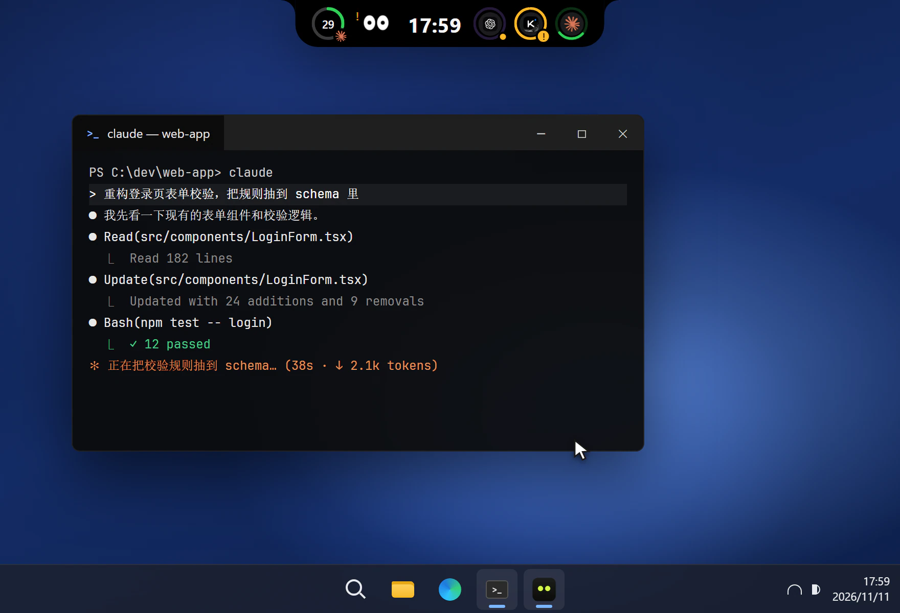
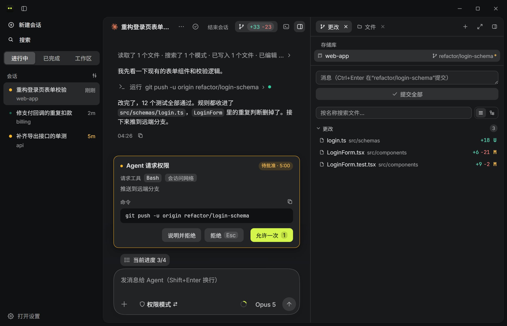
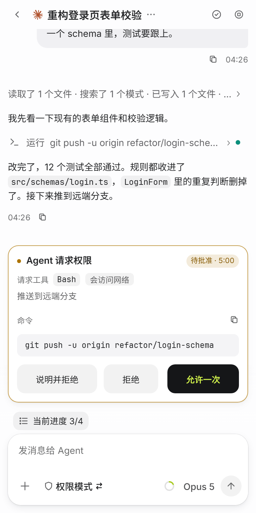

<div align="center">
  
  <h1>Meowo / 喵呜</h1>
  <p><b>同时使用多个 AI 编程 CLI 时用的桌面应用，支持 Claude Code、Codex、Kimi、Gemini CLI 和 OpenCode。</b></p>
  <p>
    <a href="https://github.com/larrygogo/meowo/actions/workflows/ci.yml"></a>
    <a href="https://github.com/larrygogo/meowo/releases/latest"></a>
    <a href="https://github.com/larrygogo/meowo/releases"></a>
    
    <a href="LICENSE"></a>
  </p>
  <p><b>中文</b> · <a href="README.en.md">English</a> · <a href="https://meowo.io">官网 meowo.io</a></p>
  <p>会话在 Meowo 的对话窗里运行，旁边可以看改动、开终端和浏览器。<br/>有会话等你处理时，屏幕顶部的灵动岛会提醒；不在电脑前，可以用手机浏览器处理。</p>
  
</div>

## 下载

到 **[meowo.io](https://meowo.io)** 下载，页面会按你的系统给出对应的安装包。也可以从 [GitHub Releases](https://github.com/larrygogo/meowo/releases/latest) 下载：

| 平台 | 安装包 | 说明 |
|------|--------|------|
| **Windows 10 / 11** | `Meowo_x.y.z_x64-installer.exe` | 双击安装；没有 WebView2 的环境会自动换成经典安装界面 |
| **macOS 14+** | Apple 芯片选 `_aarch64.dmg`，Intel 选 `_x64.dmg` | 已签名公证。不确定芯片：苹果菜单 → 关于本机 |

AI 编程 CLI 可以等装好 Meowo 之后，在设置里安装和登录，所需的 hooks 由 Meowo 配置。新版本可以在应用内检查和安装。

> **Windows 提示「Windows 已保护你的电脑」**：Windows 安装包暂时没有代码签名，点「更多信息」→「仍要运行」即可。
> 安装包由 GitHub Actions 从公开源码构建（见 [release.yml](.github/workflows/release.yml)），自动更新另有 minisign 签名校验。

## 能做什么

### 对话窗



- 在对话窗里选 Agent 和目录，输入第一句话就新建会话。可以附图片，也可以截图后标出位置再发。
- 对话按消息、工具调用、子任务分开显示，工具调用默认折叠成一行。待办清单和进度会随会话更新。
- 待批准的命令显示成审批卡，卡上写明这次操作会动到什么，比如工作区外的路径、删除文件、联网。Agent 的选择题可以在卡片上回答，终端里的信任确认和模型菜单显示成按钮。
- 会话运行在 Meowo 托管的终端里。对话和终端是同一个会话的两种视图，可以切到终端自己操作。
- 右侧面板有四个页签：更改、文件、终端、浏览器。
  - 「更改」页签显示 diff。可以对某一行写评论，再放进输入框发给 Agent。
  - 浏览器可以打开 localhost。Claude Code、Codex 和 Kimi 的会话可以自己操作这个浏览器，操作时能看到它的鼠标，你可以随时接管。
- 标题栏显示当前分支和 Pull Request，可以用编辑器打开项目。

### 灵动岛

- 灵动岛在屏幕顶部。收起时显示额度环，每个会话一个头像：运行中的头像外圈是绿色的弧，等你处理的亮一个黄点。
- 会话等待批准、提出问题、出错或运行结束时，灵动岛会展开几秒。点头像打开那个会话。
- 点开面板可以看最需要处理的会话和各家额度，也可以新建会话。
- Windows 上可以左右拖动位置，或者开极简模式只留一条细线。有刘海的 Mac 上，灵动岛围在刘海周围；没有刘海时，它在菜单栏里。

### 手机远程



- 在设置里开启「手机远程」，用手机扫码，就能在手机浏览器里使用，不需要安装 App。页面可以添加到主屏幕。
- 手机上可以查看和回复对话，处理审批和提问，新建或分叉会话，查看终端画面和改动。
- 会话需要你时，可以通过 [Bark](https://github.com/Finb/Bark)（iPhone App）推送通知。
- 「运行时防止休眠」开启后，有会话在运行时电脑不会睡眠。这个开关也可以在手机上改。
- 支持局域网和 Tailscale，推荐只绑定 Tailscale 网卡。

<br clear="right" />

### 账号、额度与网络

- Claude Code、Codex、Kimi 和 OpenCode 可以保存多个官方账号。切换账号时，Claude Code、Codex 和 Kimi 正在运行的会话可以一起切过去。Gemini CLI 只能有一个账号，用 API Key 登录。
- 没有官方账号的，可以给这家 Agent 配 API 中转。
- 显示 Claude Code、Codex 和 Kimi 的 5 小时和 7 天额度，Opus 这类模型单独计算的周额度也会列出，用到 85% 以上会变红。
- 代理可以设一个默认值，也可以给每家 Agent 单独设置。支持 HTTP 代理和带认证的写法，SOCKS 只有 Kimi 和 Gemini CLI 支持。

### 五家 Agent 的差别

五家 CLI 能用的功能不完全一样。下表取自 0.8.1 各家插件的声明，完整对照见[官网功能页](https://meowo.io/features#agents)。

| | Claude Code | Codex | Kimi Code | Gemini CLI | OpenCode |
|---|:-:|:-:|:-:|:-:|:-:|
| 在 Meowo 里登录 | 支持 | 支持 | 支持 | 填 API Key | 支持 |
| 在卡片上回答提问 | ✓ | – | ✓ | – | – |
| Agent 操作面板浏览器 | ✓ | ✓ | ✓ | – | – |
| 额度读数 | 官方账号登录时 | ChatGPT 登录时 | 官方账号登录时 | – | – |
| 上下文用量 | ✓ | ✓ | ✓ | – | – |
| 多个账号 | ✓ | ✓ | ✓ | – | ✓ |
| SOCKS 代理 | – | – | ✓ | ✓ | – |

### 本地优先

会话数据和设置只存在本机的 `~/.meowo/` 目录（SQLite）。Meowo 没有自己的服务器，不上传会话内容，断网也能用。唯一的例外是 Bark 推送：开启后，推送内容（会话标题、Agent 的最后一句话、打开会话的链接）会经过 Bark 的服务器。你在自己终端里开的会话也会出现在 Meowo 里。

## 工作原理

每家 CLI 用自己的 hook 机制把事件交给 `meowo-reporter`（OpenCode 没有 hook，改用一份自动生成的桥接插件），数据写进同一份本地数据库：

```
 AI CLI 会话（claude / codex / kimi / gemini / opencode）
   │  触发 hooks；claude 另有 statusline 提供 Context 用量
   ▼
 meowo-reporter（一次性命令行进程，写完就退出）
   ▼
 ~/.meowo/board.db（SQLite，WAL）
   ▲  文件监听，变了就刷新
 meowo-app（Tauri 桌面应用）
   ├─ 托管会话的终端（PTY），对话窗和终端看的是同一个会话
   └─ 手机远程开启时，内嵌一个只放行白名单接口的 HTTP 服务
```

启动时，Meowo 会为检测到的 CLI 自动接好 hooks：先备份，再原子写入，不破坏你已有的配置。想手动接入或排查问题，见官网的[手动接入说明](https://meowo.io/docs#manual)。数据和配置文件的位置见[数据与配置](https://meowo.io/docs#data)。

架构细节见 [`docs/architecture/`](docs/architecture/)。

## 从源码构建

需要 [Rust](https://rustup.rs/)（stable）和 [Bun](https://bun.sh/)，以及 [Tauri 前置依赖](https://tauri.app/start/prerequisites/)（Windows：WebView2 + MSVC 构建工具；macOS：Xcode 命令行工具）。

```bash
cd app
bun install
bun run tauri dev     # 开发模式，首次会编译 Rust，稍慢
bun run tauri build   # 打安装包，产物在 app/src-tauri/target/release/bundle/
```

测试与检查：

```bash
cd app && bunx tsc --noEmit && bun run test
cd app/src-tauri && cargo clippy --workspace --all-targets -- -D warnings && cargo test
```

代码结构：前端在 `app/src/`（React + TypeScript），Rust workspace 在 `app/src-tauri/`，下面有 `meowo-protocol`（跨进程契约）、`meowo-store`（SQLite）、`meowo-agent`（各家 Agent 的适配）、`meowo-reporter`（hook 上报）四个 crate；官网在 `site/`。README 的演示图由 `cd app && bun run demo:webp` 生成。

## 为什么叫 Meowo？

名字来自猫叫 **meow**，中文写作「喵呜」。

## License

[MIT](LICENSE) © larrygogo
